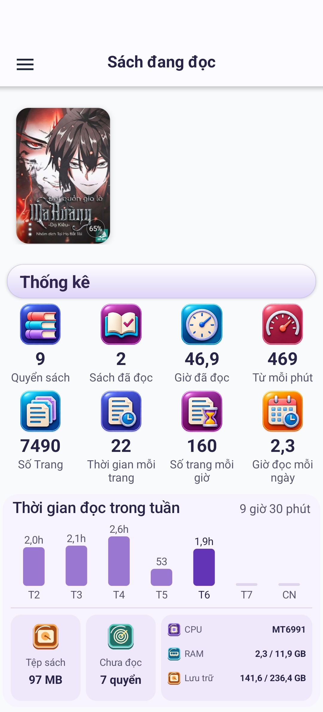
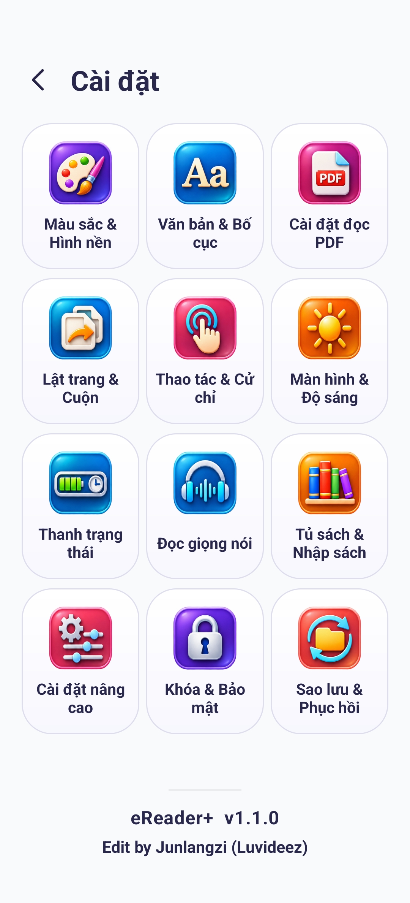
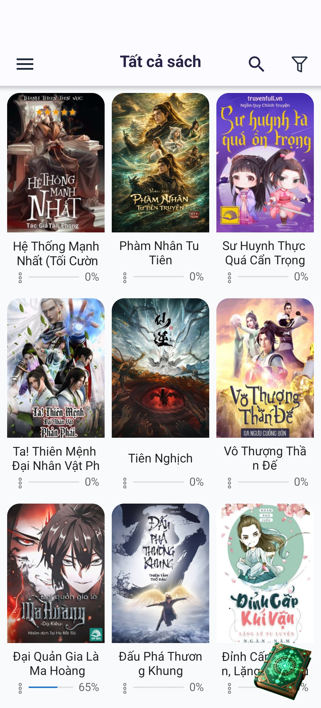

# eReader+

**eReader+** là ứng dụng đọc sách và truyện trên Android. Ứng dụng quản lý tệp sách trên thiết bị, lưu vị trí đọc và hiển thị thống kê theo tuần. Giao diện tiếng Việt, với các nhóm cài đặt riêng cho trang đọc, tủ sách và giao diện ứng dụng.

**Phiên bản trong dự án** · v1.1.0  
**Yêu cầu** · Android 5.0 trở lên (API 21)

## Ảnh giao diện

<table>
  <tr>
    <th>Sách đang đọc và thống kê</th>
    <th>Cài đặt</th>
    <th>Màn hình khởi động</th>
    <th>Tủ sách</th>
  </tr>
  <tr>
    <td></td>
    <td></td>
    <td></td>
    <td></td>
  </tr>
</table>

## Tính năng

### Tủ sách và nhập sách

- Mở một tệp sách hoặc quét thư mục để tìm nhiều sách. Có thể quét vùng lưu trữ dùng chung mà Android cho phép truy cập.
- Khi mở ứng dụng lần đầu, có thể chọn quét ngay hoặc để sau. Khi tủ sách trống, nút **Quét truyện** xuất hiện giữa màn hình.
- Xem bìa, tên sách và tiến độ đọc trong lưới **Tất cả sách**. Dùng nút tìm kiếm hoặc bộ lọc để tìm truyện trong tủ sách.
- Hỗ trợ các định dạng phổ biến như **EPUB, EPUB 3, PDF, FB2, MOBI, TXT, CBZ và CBR**.

### Đọc và tùy chỉnh trang

- Tiếp tục từ vị trí đã lưu. Có thể đánh dấu trang, tô sáng và ghi chú trong khi đọc.
- Chỉnh phông chữ, màu chữ, màu hoặc ảnh nền trang đọc, căn lề, giãn dòng và khoảng cách đoạn.
- Chọn cách lật trang hoặc cuộn, điều chỉnh vùng chạm, cử chỉ, phím bấm và độ sáng.
- Tùy chỉnh nội dung, phông chữ, căn lề và cử chỉ của thanh trạng thái trong nhóm **Thanh trạng thái**.
- Có nhóm tùy chọn riêng cho PDF và đọc thành tiếng bằng công cụ chuyển văn bản thành giọng nói của thiết bị. Giọng đọc có sẵn tùy máy và công cụ đã cài.

### Dashboard và thống kê

- Mở nhanh sách đang đọc. Menu ba chấm cho phép xem thông tin sách, tạo lối tắt trên màn hình chính, gửi tệp và xóa mục khỏi danh sách đọc gần đây.
- Xem tám chỉ số gồm số quyển sách, sách đã đọc, giờ đã đọc, từ mỗi phút, số trang, thời gian mỗi trang, số trang mỗi giờ và giờ đọc mỗi ngày.
- Xem tổng thời gian đọc trong tuần và biểu đồ theo ngày. Chạm vào **Sách đã đọc**, **Giờ đã đọc** hoặc **Từ mỗi phút** để mở danh sách sách cùng tiến độ.
- Xem dung lượng tệp sách, số sách chưa đọc, tên CPU khi thiết bị cung cấp, RAM khả dụng / tổng RAM và dung lượng lưu trữ trống / tổng dung lượng.

### Giao diện và bảo mật

- Chọn giao diện dashboard **Statin** hoặc **Pearl** trong **Cài đặt → Màu sắc & Hình nền**. Chế độ tối có bảng màu riêng.
- Màn hình khởi động dùng hình thư viện cổ, chữ vàng nổi và một thanh tải. Các nhóm cài đặt dùng icon riêng để dễ nhận diện.
- Có tùy chọn khóa ứng dụng và bốn mẫu biểu tượng ứng dụng trong **Khóa & Bảo mật**.

### Sao lưu và khôi phục

1. Mở **Cài đặt → Sao lưu & Phục hồi**, chọn **Sao lưu** và tích **Cài đặt ứng dụng**, **Truyện đang đọc và tiến độ**, hoặc cả hai.
2. Ứng dụng ghi tệp `.erd` vào thư mục `Documents`. Nếu chọn cả hai mục, chúng được lưu chung trong một tệp.
3. Chọn **Khôi phục**, mở tệp và tích những mục muốn lấy lại. Mục thiếu trong tệp hiện màu xám. Sau khi khôi phục, mở lại ứng dụng để áp dụng dữ liệu.

Mục **Truyện đang đọc và tiến độ** lưu danh sách đọc gần đây và vị trí đọc. Khi chuyển sang máy khác, hãy chép hoặc nhập lại các tệp ebook để có thể mở truyện.

## Cài đặt APK

1. Tải APK từ mục **Releases** của kho GitHub nếu bản phát hành đã được đăng.
2. Mở tệp APK trên Android. Nếu hệ thống yêu cầu, cho phép ứng dụng đang mở tệp cài đặt từ nguồn này.
3. Mở eReader+, rồi nhập một tệp sách hoặc chọn phạm vi quét. Android có thể yêu cầu quyền truy cập bộ nhớ khi quét hoặc lưu bản sao vào `Documents`.

## Cấu trúc dự án

| Thư mục | Nội dung |
|---|---|
| `app/` | Manifest, tài nguyên Android và mã Smali dùng để đóng gói APK |
| `tools/grouped_settings/` | Mã Java cho một số phần giao diện và tiện ích |
| `CUSTOM_ICON/` | Tài nguyên biểu tượng |
| `demo/` | Bốn ảnh minh họa giao diện ở trên |

Dự án đóng gói bằng **Apktool**. Các phần Java bổ sung được chuyển sang DEX và Smali trước khi đóng gói. Bản APK phát hành cần được ký bằng khóa của người duy trì.
